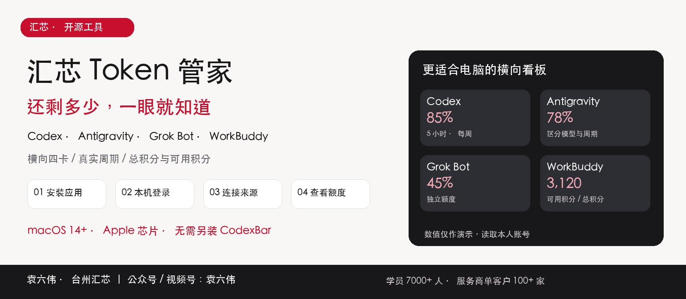
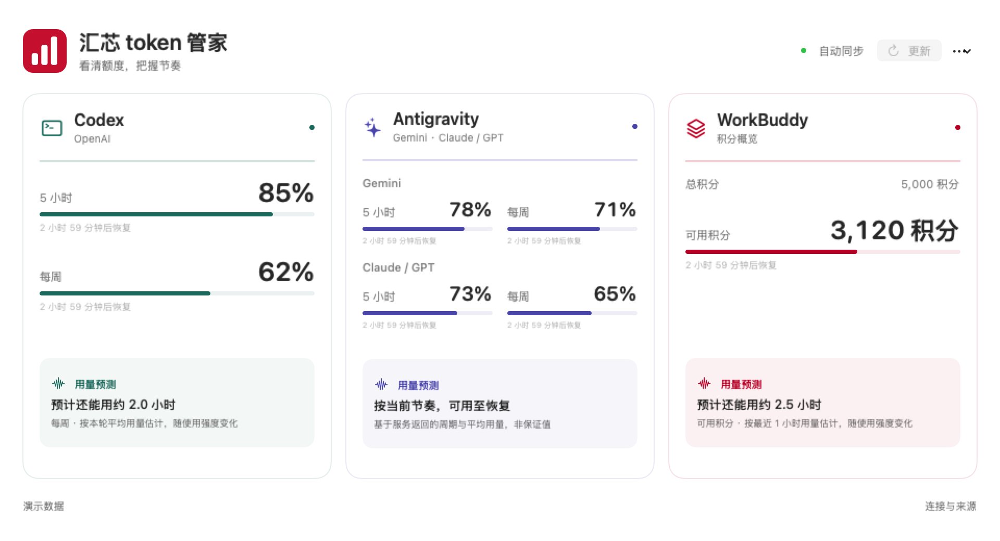

<div align="center">



# 汇芯 Token 管家
### `huixin-token-manager` · 四个 AI 工具的剩余额度，放进一个横向中文面板

[](#二安装与快速开始)
[](#三数据怎样读取)
[](#四常见问题)
[](LICENSE)

> **袁六伟 · 台州汇芯（公众号/视频号：袁六伟）**｜一人 AI 公司创始人，学员 7000+ 人，服务商单客户 100+ 家，覆盖近 20 个行业，得到 / 华为分享老师。AI 变现实战派，自己跑通才拿出来教。

**[下载 Mac 安装包](https://github.com/sixwei2025/huixin-token-manager/releases/latest)** · **免费开源，用户与合伙人均可使用**

**适用：Apple 芯片 Mac（M1/M2/M3/M4 等），macOS 14 及以上。Windows / Intel Mac 暂不支持。无需另装 CodexBar。**

```bash
# 可选：安装使用指引 Skill，不等于安装桌面应用
npx skills add sixwei2025/huixin-token-manager
```
```bash
# 从源码构建桌面应用
 git clone https://github.com/sixwei2025/huixin-token-manager.git
 cd huixin-token-manager && bash scripts/build.sh
```

[实际界面](#一界面与用途) · [安装使用](#二安装与快速开始) · [数据来源](#三数据怎样读取) · [常见问题](#四常见问题) · [源码与边界](#五仓库与开源边界)

</div>

## 版本记录

当前版本：`v1.0.3` · 2026-11-13
完整变化记录见 [CHANGELOG.md](CHANGELOG.md)。


## 新手安装：把链接发给 AI

打开 Codex、WorkBuddy，或其他支持技能安装的 AI 智能体，把下面这段话直接发到对话框，让它帮你安装：

```text
帮我安装这个仓库里的技能：
https://github.com/sixwei2025/huixin-token-manager
```

不需要自己先敲安装命令，按 AI 的提示完成即可。安装后可以接着问：“这个技能怎么用？带我做一个最简单的例子。”

需要使用能够读取仓库、操作本地文件并支持技能安装的 AI；如果当前平台不支持，它可以提供手动安装指引。部分技能还需要额外软件或账号配置，安装技能与完成这些配置是两步，按本页说明和 AI 提示继续。

本仓库同时提供桌面应用和配套助手 Skill。上面这句话用于安装配套 Skill；如果你要使用桌面应用，请再告诉 AI：“请继续帮我安装并打开桌面应用。”具体系统要求见下方安装说明。


## 一、界面与用途



上图由本应用真实渲染，底部明确标记“演示数据”；数值不代表作者或任何用户的真实账号额度。安装后读取你本机已登录账号的真实数据。

| 使用时的困扰 | 本版的处理方式 |
|---|---|
| 从上到下的长竖菜单，不适合电脑横屏 | 820×588 横向双列四卡，无需翻长菜单 |
| 邮箱、消费预测等信息过多 | 默认展示剩余额度、周期、恢复时间 |
| 分不清用量百分比是已用还是剩余 | 主面板统一显示剩余百分比 |
| 把不同工具都套成相同周期 | 只展示真实提供的周期；WorkBuddy 展示总积分与可用积分 |
| 把 Cursor 总额度当成 Grok Bot 额度 | 仅采用 Grok Bot 的独立额度字段 |
| 原工具连不上还显示旧数值 | 显示“上次数据”或连接问题，未读取不冒充 0% |

## 二、安装与快速开始

### 适用范围

| 项目 | 当前范围 |
|---|---|
| 操作系统 | macOS 14 或更新版本 |
| 芯片 | Apple Silicon：M1、M2、M3、M4 及同架构机型 |
| Windows / Intel Mac / Linux | 暂不支持；本仓库不提供这些平台的安装包 |
| 原版 CodexBar | 无需安装或运行；已内置开源读取引擎 |
| 账号 | 使用者需要自己拥有并登录相应工具的账号 |
| 费用 | 本工具免费开源；不会赠送、增加或共享第三方工具额度 |
| Apple 签名 | 本地临时签名，尚未进行 Apple 开发者签名与公证 |

### 下载应用

1. 打开 [最新版本下载页](https://github.com/sixwei2025/huixin-token-manager/releases/latest)，下载名称含 `macos-arm64.zip` 的文件。
2. 解压，将“汇芯 Token 管家.app”拖入“应用程序”。
3. 打开应用后常驻菜单栏右侧的**小柱状图图标**，鼠标停留显示“汇芯 Token 管家”；点击图标可收起或展开。关闭面板后继续后台运行，位置可随 macOS 菜单栏设置保留。再次打开应用也能展开面板。右上角“…”可打开独立窗口、查看连接说明或退出。
4. 如果系统阻止打开，请按 macOS 正常的安全设置流程处理；不要关闭系统安全保护。也可以自行从源码构建。

安装包不包含作者的账号、密码、Cookie、额度缓存或知识库。你需要先在本机登录自己的工具，且应按系统提示自行决定是否允许浏览器会话或钥匙串读取。

### 四个工具如何连接

| 工具 | 本机前提与显示内容 |
|---|---|
| Codex | 安装并登录 Codex CLI；显示可取得的短周期和每周额度。若 PATH 中找不到命令，请确认本机 CLI 安装正确 |
| Antigravity | 本机已安装、登录并运行 Antigravity，或存在上游支持的登录来源；分开显示 Gemini 与 Claude/GPT 的真实周期 |
| Grok Bot | 需要与 Cursor 体系匹配的账号会话和独立 Grok Bot 额度；若账号没有该字段，显示未读取，不拿总额度替代 |
| WorkBuddy | 本机浏览器已登录 WorkBuddy 网站且读取引擎支持该浏览器会话；显示当前积分包合计总积分与可用积分 |

默认每分钟更新一次，也可手动刷新。各服务的接口、登录方式与套餐不同，不能保证任意账号都返回同样的数据。具体连接与首次授权说明见 [连接说明](docs/CONNECTIONS.md)，本次验证边界见 [验证记录](docs/VALIDATION.md)。

### 自行构建

需要 Apple 芯片 Mac 和含 Swift 6.2+ 的 Xcode 命令行工具（运行安装包仍支持 macOS 14+）。运行 `bash scripts/build.sh`，脚本会从 CodexBar 官方 v0.84.0 发布包取得引擎并校验固定 SHA-256，并从同一固定提交编译持续运行的浏览器读取桥接程序，然后编译界面、临时签名、运行样本检查，生成 `build/汇芯 Token 管家.app` 与 ZIP。源码构建需要访问 GitHub；正常安装不需要下载额外引擎。

## 三、数据怎样读取


| 步骤 | 输入和处理 | 检查与输出 |
|---|---|---|
| 1 本机登录 | 使用者自己的 CLI / 应用 / 浏览器会话 | 缺少登录时显示连接问题，不借用作者账号 |
| 2 内置引擎 | CodexBarCLI 官方 v0.84.0 固定版本 | 引擎随安装包提供；构建时检查 SHA-256 |
| 3 字段适配 | 区分周期、模型与独立额度 | 剩余百分比 = 100 − 已用百分比；限制在 0–100% |
| 4 中文展示 | 四卡横向布局、积分、恢复时间 | 超时终止子进程；失败标记旧数据 |

临时签名应用按上游保护机制，将浏览器会话保存在读取进程的内存中。WorkBuddy 与 Grok Bot 的连接和自动刷新复用同一个读取进程，不再每次启动新程序而丢失连接。会话不写入明文文件；完全退出或升级后可能需要重新连接浏览器。

**来源致谢：** 额度读取来自 [Peter Steinberger 的 CodexBar](https://github.com/steipete/CodexBar)，MIT。汇芯重新开发了中文原生界面、精简卡片、真实字段适配和独立打包；没有把上游读取能力说成完全原创。上游源码版本、二进制校验值和本次修改范围见 [NOTICE](NOTICE) 与 [许可证目录](licenses)。

## 四、常见问题

**Windows 能不能用？** 当前不能。界面和部分读取逻辑依赖 macOS；Windows 需要单独适配和验证，不能通过重命名安装包支持。本项目尚无 Windows 版，不提供跨平台承诺。

**要不要安装 CodexBar？** 不需要。安装包已内置读取引擎。保留开源来源说明不代表用户还需要安装原应用。

**为什么不是每个工具都有 5 小时和每周额度？** 各工具规则不同，只展示数据实际提供的周期。WorkBuddy 使用积分制，显示总积分与可用积分；总积分是当前积分包总量，不是账号历年累计所得积分，奖励分组不重复相加。

**“0%”和“读取失败”有什么区别？** 0% 表示来源确实返回额度耗尽。读取失败会显示通用错误；已有旧数值会明确标记“上次数据”，不会推算恢复后的新额度。

**菜单栏没有图标怎么办？** v1.0.2 已补齐标准 macOS 应用包信息。请解压并拖入“应用程序”后正常打开，不直接运行包内的程序文件。macOS 26 及以上若隐藏图标，请打开“系统设置→菜单栏→允许在菜单栏显示”，检查“汇芯 Token 管家”已开启。菜单栏空间不足时仍由 macOS 控制显示位置。

**数据会发给汇芯吗？** 本版没有汇芯账号体系、汇芯服务器、遥测或集中收集额度功能。内置引擎会访问对应工具服务以取得本人的额度。缓存仅包含标准化额度、更新时间和通用错误。浏览器会话、登录文件和钥匙串访问由上游读取逻辑及系统权限管理；不要在公开 issue 上传完整原始响应或登录文件。

**安装 Skill 就能打开应用吗？** 不能。Skill 是可选的安装与排查指引；桌面应用仍需下载 ZIP 或从源码构建。

## 五、仓库与开源边界

```text
huixin-token-manager/
├── Sources/                  # SwiftUI 界面与额度适配
├── Bridge/                   # 固定版本 CodexBarCore 的常驻读取程序
├── scripts/build.sh          # 编译、签名、检查、ZIP
├── scripts/fetch-engine.sh   # 固定上游版本及 SHA-256 校验
├── Tests/fixtures/           # 无账号信息的演示/校验样本
├── skills/huixin-token-manager/SKILL.md
├── assets/showcase/          # 品牌图和演示模式窗口
├── docs/CONNECTIONS.md       # 连接与排查
├── licenses/                 # 上游及依赖许可
├── LICENSE
└── NOTICE
```

代码与配套指引公开，用户和合伙人可按 MIT 条款使用、修改和分发，并保留版权及许可。第三方引擎归原作者所有；本工具与 OpenAI、Google、Cursor、腾讯及 CodexBar 作者无官方从属或背书关系。当前仅提供四项工具的本机个人看板，不提供多用户账号管理、额度共享、远程读取、额度交易或修改第三方额度。官方接口变动可能导致读取失效，欢迎提交不含隐私的复现信息。

### 关于作者与同系列开源项目

袁六伟 · 台州汇芯（公众号/视频号：袁六伟）。一人 AI 公司创始人，学员 7000+ 人，服务商单客户 100+ 家，覆盖近 20 个行业，得到 / 华为分享老师。AI 变现实战派，自己跑通才拿出来教。

| 项目 | 用途 |
|---|---|
| [汇芯技能管家](https://github.com/sixwei2025/huixin-skills-manager) | 本地技能中文浏览与分类管理 |
| [公众号封面渲染引擎](https://github.com/sixwei2025/wechat-cover-skill) | 公众号封面制作 |
| [公众号排版工具](https://github.com/sixwei2025/gzh-million-layout-skill) | 手机阅读排版 |
| [工具评测写作](https://github.com/sixwei2025/ai-tool-review-wechat-skill) | 真实工具评测内容制作 |
| [本地视频中心](https://github.com/sixwei2025/local-video-hub) | 本地视频作品管理 |
| [口播视频制作](https://github.com/sixwei2025/talking-head-video-skill) | 口播视频制作 |
| [三维地图视频](https://github.com/sixwei2025/3d-map-video-skill) | 地图讲解视频制作 |
| [动态图解视频](https://github.com/sixwei2025/dark-infographic-video-skill) | 数据图解与短视频制作 |
| [书籍提炼工具](https://github.com/sixwei2025/book-skill) | 将书籍方法整理为可复用技能 |
| [历史认知方法](https://github.com/sixwei2025/huangdi-skill) | 历史材料与决策方法学习 |
| [标题策划](https://github.com/sixwei2025/hit-title-expert-skill) | 内容标题策划 |
| [可视化教程](https://github.com/sixwei2025/auto-tutorial-skill) | 软件使用教程制作 |
| [心理科普视频](https://github.com/sixwei2025/psych-kepu-video-skill) | 心理科普动画 |
| [一人公司方法库](https://github.com/sixwei2025/yuanliuwei-ai-skills) | 一人公司业务方法 |
| [内容选题雷达](https://github.com/sixwei2025/sunrise-tracker) | 内容选题监测 |


| [汇芯 Token 管家](https://github.com/sixwei2025/huixin-token-manager) | 四个 AI 工具的本机额度看板 |
