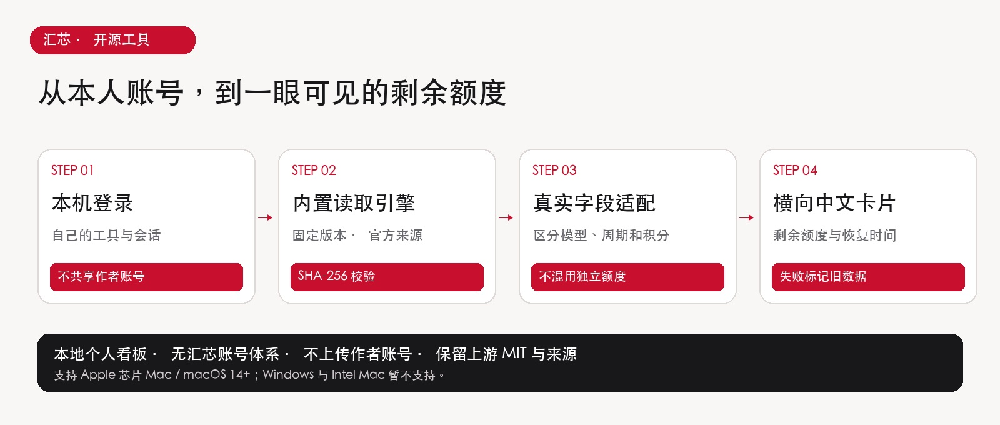

<div align="center">


# 汇芯 token 管家

**额度可视化 · 用量预测 · 自动同步**

当前版本：`v1.1.2` · 2026-11-24 · Apple Silicon / macOS 14+

[下载安装包](https://github.com/sixwei2025/huixin-token-manager/releases/latest) · [更新记录](CHANGELOG.md) · [MIT 许可](LICENSE)

袁六伟 · 台州汇芯（公众号/视频号：袁六伟）

</div>

> 我是袁六伟，台州汇芯创始人，得到 / 华为的分享老师，多家企业的 AI 落地顾问；累计带出实战学员 7,000+，服务企业商单客户 100+（覆盖近 20 个行业）。

## 新手安装：把链接发给 AI

```text
帮我安装并打开这个仓库的 macOS 桌面应用：
https://github.com/sixwei2025/huixin-token-manager
请使用最新发行版，并确认右上角菜单栏图标显示。
```

这是桌面应用。`npx skills add sixwei2025/huixin-token-manager` 只安装配套使用助手，不等于安装桌面应用。需要能读取仓库并操作本机文件的 AI；浏览器登录和系统授权由使用者本人完成。

## 一、只做两件事

**看清额度：** 一个原创三栏面板显示 Codex、Antigravity、WorkBuddy。分别展示短周期、每周额度、Gemini 与 Claude/GPT 周期，以及 WorkBuddy 总积分和可用积分。Grok Bot 已移除。

**把握节奏：** 用量预测优先参考有效的近期消耗记录，数据不足时使用 CodexBarCore 返回的真实周期均速预测。未提供周期且历史不足时显示正在积累记录，绝不编造耗尽时间。额度恢复、充值、套餐容量变化后重新计算近期趋势。


截图使用本应用演示模式，展示数值不代表任何真实账号。应用图标、页面图标与菜单栏采用同一套三柱标识。右上角菜单栏入口为 **token**，提示名称为 **汇芯 token 管家**。

手动更新只保留右上角一个按钮，卡片内不重复放刷新按钮。菜单栏有启动位置自检，避免更新后按钮脱离可见区域。

## 二、安装与使用

1. 下载 [最新 Release](https://github.com/sixwei2025/huixin-token-manager/releases/latest) 的 `macos-arm64.zip`。
2. 解压，将“汇芯 token 管家.app”放入“应用程序”，替换旧版并重新打开。
3. 点击右上角菜单栏的柱状图 **token**。面板关闭后继续后台同步。
4. 如果 macOS 26 隐藏图标：系统设置 → 菜单栏 → 允许在菜单栏显示 → 打开“汇芯 token 管家”。

支持 Apple Silicon Mac、macOS 14 及以上；暂不提供 Windows、Intel Mac、Linux 安装包。应用使用本地临时签名，尚未 Apple 开发者签名与公证；按 macOS 正常安全流程打开，不关闭系统安全保护。无需安装原版 CodexBar。

| 工具 | 如何连接 |
| --- | --- |
| Codex | 读取上游支持的本机登录来源；需要先安装并登录 Codex / Codex CLI。 |
| Antigravity | 先在本机安装并登录 Antigravity，再打开管家。 |
| WorkBuddy | 在 Chrome 登录 `www.workbuddy.cn`，点“连接 WorkBuddy”，本人处理可能出现的系统钥匙串授权。桌面客户端登录不等于网页登录。 |

WorkBuddy 复用上游 Chrome 会话、User-Agent 匹配及官方网页计费接口适配，不读取或解密桌面客户端的加密 Token。登录或授权失效时显示连接入口并停止后台授权重试，其他服务继续刷新。会话保存在对应的读取进程内存中；重启或升级后可能需要重新连接。[详细连接说明](docs/CONNECTIONS.md)

## 三、后台如何工作



- **常驻读取：** 按服务分别运行 CodexBarCore 桥接进程，复用会话。一个服务慢，不阻塞另外两个。
- **独立刷新：** 默认每 30 秒、低电量模式每 60 秒；唤醒或联网后自动同步。打开面板直接显示缓存，不触发整页等待。
- **有界等待：** 常规 Codex 同步最多约 12 秒，Antigravity / WorkBuddy 最多约 20 秒；超时结束本次读取并保留上次数据。首次本人授权可等待更久。
- **失败退避：** 临时故障逐步延长重试，最长 5 分钟；登录或授权失效则等待主动连接。每个服务独立去重。
- **可解释预测：** 周期均速来自上游 `UsagePace`；近期预测至少需要 3 个有效观测、跨 10 分钟且有实际消耗。近期记录仅保留最多 2 小时，不跨恢复或充值拼接。
- **本机缓存：** 只保存展示用额度、更新时间与匿名趋势；不保存邮箱、密码、Cookie 或原始登录响应。不需要后台服务器。

预测为当前使用节奏的估计，遇到突发用量、服务端更新延迟或计费变化会偏离实际；数据过期或读取失败时暂停当前预测。

## 四、特别致敬与感谢 CodexBar

**感谢 [Peter Steinberger](https://github.com/steipete) 和 [CodexBar](https://github.com/steipete/CodexBar) 社区。** 正是上游对多服务读取、浏览器授权、会话保护、额度周期与更新策略的持续打磨，让这个精简产品成为可能。

本项目直接复用 **CodexBarCore v0.85.0** 的读取、凭据来源选择、WorkBuddy 网页计费适配、浏览器会话保护和周期均速预测，固定提交为 `5dd48cab770a326691b25a124d37ffee12c5f7ac`。这些能力源于上游，不能归为我们的原创。

汇芯原创部分是三栏中文界面、统一视觉图标、按服务隔离的进程管理、轻量自动同步、匿名近期趋势与预测展示。没有复制上游界面布局或使用上游截图冒充本产品。

CodexBar 使用 MIT 许可，允许在保留许可与版权声明的条件下复用。本项目保留 [NOTICE](NOTICE)、[依赖许可](licenses/) 和应用内来源入口。构建中仅对上游一个函数加编译兼容注解，保留授权与拒绝机制，详见 [补丁脚本](scripts/prepare-bridge.py)。

## 五、自行构建与验证

需要 Apple Silicon Mac、Swift 6.2+ / Xcode 命令行工具：

```bash
git clone https://github.com/sixwei2025/huixin-token-manager.git
cd huixin-token-manager
bash scripts/build.sh
```

脚本解析固定上游源码，编译常驻桥接与原创界面，打包资源和许可，临时签名，检查 JSON 协议、展示数据、刷新策略与预测边界，生成 `build/汇芯 token 管家.app` 和对应 ZIP。首次编译上游核心可能需要较长时间；后续增量构建复用缓存。不需要额外下载或运行原版 CodexBar 应用。

验证事实和限制见 [验证记录](docs/VALIDATION.md)。提交问题时请提供版本、系统与通用错误，不要上传登录文件、原始 API 响应或 Cookie。

### 关于作者与同系列开源项目

袁六伟 · 台州汇芯（公众号/视频号：袁六伟）。一人 AI 公司创始人，学员 7000+ 人，服务商单客户 100+ 家，覆盖近 20 个行业，得到 / 华为分享老师。AI 变现实战派，自己跑通才拿出来教。

| 项目 | 用途 |
|---|---|
| [汇芯技能管家](https://github.com/sixwei2025/huixin-skills-manager) | 本地技能中文浏览与分类管理 |
| [公众号封面渲染引擎](https://github.com/sixwei2025/wechat-cover-skill) | 公众号封面制作 |
| [公众号排版工具](https://github.com/sixwei2025/gzh-million-layout-skill) | 手机阅读排版 |
| [工具评测写作](https://github.com/sixwei2025/ai-tool-review-wechat-skill) | 真实工具评测内容制作 |
| [本地视频中心](https://github.com/sixwei2025/local-video-hub) | 本地视频作品管理 |
| [口播视频制作](https://github.com/sixwei2025/talking-head-video-skill) | 口播视频制作 |
| [三维地图视频](https://github.com/sixwei2025/3d-map-video-skill) | 地图讲解视频制作 |
| [动态图解视频](https://github.com/sixwei2025/dark-infographic-video-skill) | 数据图解与短视频制作 |
| [书籍提炼工具](https://github.com/sixwei2025/book-skill) | 将书籍方法整理为可复用技能 |
| [历史认知方法](https://github.com/sixwei2025/huangdi-skill) | 历史材料与决策方法学习 |
| [标题策划](https://github.com/sixwei2025/hit-title-expert-skill) | 内容标题策划 |
| [可视化教程](https://github.com/sixwei2025/auto-tutorial-skill) | 软件使用教程制作 |
| [心理科普视频](https://github.com/sixwei2025/psych-kepu-video-skill) | 心理科普动画 |
| [一人公司方法库](https://github.com/sixwei2025/yuanliuwei-ai-skills) | 一人公司业务方法 |
| [内容选题雷达](https://github.com/sixwei2025/sunrise-tracker) | 内容选题监测 |


| [汇芯 token 管家](https://github.com/sixwei2025/huixin-token-manager) | 四个 AI 工具的本机额度看板 |
